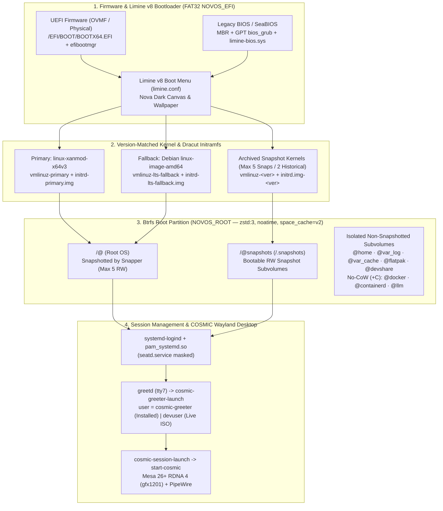

# NovOS System Architecture

[**← Back to README**](../README.md) · [**Build & QEMU Verification**](BUILD_AND_TEST.md) · [**Modular Profiles**](PROFILES.md) · [**Branding & Nova Theme**](BRANDING_AND_THEME.md)

---

## 1. Architectural Overview

NovOS (`2026.10 "Nova"`) is engineered around four non-negotiable architectural invariants:

1. **Unified Debian Unstable (`sid`) Base with Hardened APT Locks:** Eliminates cross-release ("Frankendebian") ABI conflicts while preventing APT conflict resolution from ever removing core init, PAM session, filesystem, or bootloader packages.
2. **Dual-Kernel & Version-Archived Snapshot Booting:** Pairs `linux-xanmod-x64v3` (primary) with a locked Debian `linux-image-amd64` kernel (fallback) and archives exact `/boot/efi/kernels/vmlinuz-<version>` + `initrd.img-<version>` pairs so every historical Btrfs snapshot boots with its matching `/lib/modules/<version>` tree.
3. **Anti-Bloat 10-Subvolume Btrfs Isolation:** Restricts `/` (`@`) snapshots strictly to the core OS and system packages (~3–5 GiB), isolating `/home`, `/var/log`, `/var/cache`, `/var/lib/docker`, `/var/lib/containerd`, `/var/lib/flatpak`, `/srv/llm`, and `/srv/devshare` into independent Btrfs subvolumes.
4. **Resilient Wayland Desktop & Hybrid UEFI/BIOS Installer:** Runs COSMIC Desktop exclusively over `systemd-logind` (`pam_systemd.so`) with multi-tier GPU fallback (`hardware EGL` → `LIBGL_ALWAYS_SOFTWARE=1` → `tuigreet`) and installs cleanly on both UEFI and Legacy BIOS/SeaBIOS systems via a custom Calamares `limine-bootloader` module.



---

## 2. Unified Debian `sid` Base & APT Protection Locks

Provisioned in [`scripts/stages/02-bootstrap-chroot.sh`](../scripts/stages/02-bootstrap-chroot.sh) and [`scripts/stages/03-core-system.sh`](../scripts/stages/03-core-system.sh).

### Why Unified `sid`?
Mixing Debian Stable (`trixie`) with `unstable` repositories (`debian-cosmic`, `sid`) triggers library transitions where APT's solver can propose removing `libpam-systemd` (breaking `$XDG_RUNTIME_DIR` and user D-Bus) or core package utilities. NovOS bootstraps directly into unified Debian `sid` (`main contrib non-free non-free-firmware`) with `i386` multiarch enabled for 32-bit Vulkan/Wine compatibility.

### Core Package Removal Locks
Two configuration files harden APT inside the target system:

1. **`/etc/apt/preferences.d/00-protect-core`:** Pins critical session, init, storage, and package-management binaries at `Pin-Priority: 1000`:
   ```text
   Package: apt apt-utils dpkg systemd systemd-sysv libpam-systemd dbus dbus-user-session login passwd sudo util-linux util-linux-extra btrfs-progs dracut kmod greetd
   Pin: release *
   Pin-Priority: 1000
   ```
2. **`/etc/apt/apt.conf.d/01-novos-safety`:** Disables automatic removals (`APT::Get::AutomaticRemove "false"`) and protects all kernel and firmware packages via `APT::NeverAutoRemove` regexes (`^firmware-.*`, `^linux-image-.*`, `^linux-headers-.*`, `^linux-xanmod-.*`).

### Pre-Configured Third-Party APT Keyrings
Stage 3.2 installs GPG keyrings into `/etc/apt/keyrings/` and configures signed source lists in `/etc/apt/sources.list.d/`:
* **XanMod Kernel (`xanmod-release.list`):** `http://deb.xanmod.org sid main`
* **Debian COSMIC (`debian-cosmic.list`):** `https://rickysarraf.github.io/debian-cosmic/ unstable main`
* **Docker Engine (`docker.list`):** `https://download.docker.com/linux/debian trixie stable`
* **Visual Studio Code (`vscode.list`):** `https://packages.microsoft.com/repos/code stable main`
* **Google Antigravity (`antigravity.list`):** `https://us-central1-apt.pkg.dev/projects/antigravity-auto-updater-dev/ antigravity-debian main`

---

## 3. Dual-Kernel & Version-Archived Snapshot Architecture

Provisioned in [`scripts/stages/03-core-system.sh`](../scripts/stages/03-core-system.sh) (Stages 3.5–3.8).

### Installed Kernels & Graphics Stack
* **Primary Kernel:** `linux-xanmod-x64v3` (optimized for x86-64-v3 / AMD Zen 5 microarchitectures with low-latency scheduling and `split_lock_detect=off nowatchdog`).
* **Fallback Kernel:** `linux-image-amd64` + `linux-headers-amd64` (marked `apt-mark manual` so a mainline Debian kernel is always available).
* **CPU Erratum Mitigation (`clearcpuid=rdseed`):** All Limine kernel command lines include `clearcpuid=rdseed loglevel=3` to pre-clear `X86_FEATURE_RDSEED` before early x86 CPU initialization, preventing `x86/cpu: RDSEED32 is broken` warnings on AMD Zen 5 and VirtualBox/KVM hypervisors.
* **Graphics & Firmware:** `firmware-amd-graphics`, `amd64-microcode`, `intel-microcode`, and Mesa 26+ 64-bit/32-bit drivers (`mesa-vulkan-drivers`, `mesa-vulkan-drivers:i386`, `mesa-va-drivers`, `mesa-opencl-icd`) with native RDNA 4 (`gfx1201` / RX 9070 XT) support.

### Dracut Universal Initramfs (`/etc/dracut.conf.d/10-novos.conf`)
Instead of host-specific initramfs images, NovOS configures `dracut` with `hostonly="no"` and `compress="zstd"`, embedding all storage, filesystem, USB, hypervisor, and GPU drivers required for bare-metal NVMe/SATA, USB enclosures, and VMs (QEMU VirtIO, VirtualBox, VMware):
```ini
hostonly="no"
add_dracutmodules+=" btrfs "
add_drivers+=" btrfs nvme ahci ata_piix ata_generic sd_mod sr_mod cdrom isofs uas usb_storage xhci_pci xhci_hcd ehci_pci ehci_hcd uhci_hcd ohci_pci ohci_hcd usbhid hid_generic vfat fat nls_cp437 nls_ascii virtio_blk virtio_scsi virtio_pci virtio_net virtio_gpu vmwgfx vboxvideo vboxguest qxl bochs amdgpu drm_kms_helper "
install_items+=" /bin/kmod /usr/bin/zstd /usr/bin/xz "
compress="zstd"
```

### Kernel Post-Install Hook (`/etc/kernel/postinst.d/zz-sync-limine`)
Whenever a kernel is installed or upgraded, `zz-sync-limine`:
1. Generates `/boot/initrd.img-${VERSION}` via `dracut` if not already present.
2. Archives the exact versioned pair to `/boot/efi/kernels/vmlinuz-${VERSION}` and `/boot/efi/kernels/initrd.img-${VERSION}`.
3. Updates `/boot/efi/kernels/vmlinuz-primary` (if the version matches `xanmod|liquorix`) or `/boot/efi/kernels/vmlinuz-lts-fallback`, writing the active version string to `primary.version` or `fallback.version`.

### Limine Snapshot Synchronization (`/usr/local/sbin/update-limine-snapshots`)
Triggered automatically after every APT transaction via `/etc/apt/apt.conf.d/99-limine-snapshots` (enabled on installed systems by Calamares):
1. **Snapshot Retention Pruning:** Inspects `/.snapshots/[0-9]*` and deletes the oldest Btrfs snapshot subvolumes (`btrfs subvolume delete`) whenever the count exceeds `MAX_SNAPSHOTS=5`.
2. **Read-Write Snapshot Promotion:** Iterates over the up to 5 most recent snapshots in `/.snapshots/<num>/snapshot` and executes:
   ```bash
   btrfs property set -ts "/.snapshots/${num}/snapshot" ro false
   ```
   This guarantees that selecting any snapshot in the Limine boot menu boots directly into a fully writable root filesystem without requiring manual remounting.
3. **Version-Matched Kernel Binding:** Inspects `/.snapshots/${num}/snapshot/lib/modules/` to identify the exact kernel version installed inside that snapshot, binding its Limine menu entry to `boot():/kernels/vmlinuz-${snap_kver}` and `boot():/kernels/initrd.img-${snap_kver}`.
4. **ESP Kernel Garbage Collection:** Tracks all kernels referenced by `primary.version`, `fallback.version`, and active snapshots, and deletes older unreferenced kernels on `/boot/efi/kernels/` beyond `MAX_HISTORICAL_KERNELS=2`.
5. **Multi-Path Config Sync:** Writes the generated menu to `/boot/efi/limine/limine.conf`, `/boot/efi/boot/limine/limine.conf`, `/boot/efi/limine.conf`, and `/boot/efi/EFI/BOOT/limine.conf`.

---

## 4. Anti-Bloat 10-Subvolume Btrfs Layout

Configured across [`calamares/modules/mount.conf`](../calamares/modules/mount.conf), [`calamares/modules/fstab.conf`](../calamares/modules/fstab.conf), and [`calamares/modules/limine-bootloader/main.py`](../calamares/modules/limine-bootloader/main.py).

| Subvolume | Target Mountpoint | Mount Options | `chattr +C` (No-CoW) | Architectural Role |
| :--- | :--- | :--- | :---: | :--- |
| `@` | `/` | `subvol=/@,noatime,compress=zstd:3,space_cache=v2` | No | Root OS & system binaries; snapshotted by Snapper |
| `@home` | `/home` | `subvol=/@home,noatime,compress=zstd:3,space_cache=v2` | No | Persistent user home directories |
| `@snapshots` | `/.snapshots` | `subvol=/@snapshots,noatime,compress=zstd:3,space_cache=v2` | No | Snapper snapshot subvolumes |
| `@var_log` | `/var/log` | `subvol=/@var_log,noatime,compress=zstd:3,space_cache=v2` | No | Persistent system logs across rollbacks |
| `@var_cache` | `/var/cache` | `subvol=/@var_cache,noatime,compress=zstd:3,space_cache=v2` | No | APT & package caches excluded from snapshots |
| `@docker` | `/var/lib/docker` | `subvol=/@docker,noatime,compress=zstd:3,space_cache=v2` | **Yes (`+C`)** | Docker Engine volumes & overlay layers |
| `@containerd` | `/var/lib/containerd` | `subvol=/@containerd,noatime,compress=zstd:3,space_cache=v2` | **Yes (`+C`)** | Containerd image store |
| `@flatpak` | `/var/lib/flatpak` | `subvol=/@flatpak,noatime,compress=zstd:3,space_cache=v2` | No | System-wide Flatpak apps & runtimes |
| `@llm` | `/srv/llm` | `subvol=/@llm,noatime,compress=zstd:3,space_cache=v2` | **Yes (`+C`)** | Ollama, Hugging Face, ComfyUI & Open WebUI models |
| `@devshare` | `/srv/devshare` | `subvol=/@devshare,noatime,compress=zstd:3,space_cache=v2` | No | Samba `[DevShare]` shared workspace |

> [!NOTE]
> **Why `chattr +C` on `@docker`, `@containerd`, and `@llm`?**
> Random write workloads inside multi-gigabyte LLM model files (`.gguf`, `.safetensors`) and container image databases cause severe Btrfs extent fragmentation when Copy-on-Write (CoW) is active. Stage 6 and the Calamares post-install hook apply `chattr +C` to these directories before models or containers are written.

---

## 5. Display Manager & COSMIC Desktop Stack

Provisioned in [`scripts/stages/04-cosmic-desktop.sh`](../scripts/stages/04-cosmic-desktop.sh).

### Exclusive `systemd-logind` Seat Ownership
* `seatd.service` is explicitly disabled and masked (`systemctl mask seatd.service`), and no `seat` group is created. This forces `libseat1` and `cosmic-comp` to acquire DRM/input devices exclusively through `systemd-logind` and `pam_systemd.so`.
* `/etc/pam.d/common-session` is verified to include `session optional pam_systemd.so`, guaranteeing `$XDG_RUNTIME_DIR` (`/run/user/<uid>`) and the user D-Bus session socket (`/run/user/<uid>/bus`) on every login.

### Native Graphical `cosmic-greeter` & Multi-Tier Fallback
`/usr/bin/cosmic-greeter` is a multi-call binary that checks `getpwuid(getuid())->pw_name` at startup:
* When `pw_name == "cosmic-greeter"`, it executes the login greeter UI (`cosmic_greeter::greeter::main`) over `$GREETD_SOCK`.
* When `pw_name != "cosmic-greeter"`, it enters Wayland session-locker mode (`cosmic_greeter::locker::main`).

Accordingly, NovOS configures `/etc/greetd/config.toml` on installed systems to run `/usr/local/bin/cosmic-greeter-launch` as `user = "cosmic-greeter"` on `vt = 7`:

1. **Tier 1 (Hardware EGL/KMS):** `cosmic-greeter-launch` waits up to 5 seconds for `/dev/dri/card*` and runs `dbus-run-session -- /usr/bin/cosmic-comp /usr/local/bin/cosmic-greeter-app` (which spawns `/usr/bin/cosmic-bg &` for the Nova wallpaper followed by `/usr/bin/cosmic-greeter`).
2. **Tier 2 (Software Rendering Retry):** If hardware EGL exits non-zero (e.g., on virtualized GPUs lacking full Vulkan/EGL support), `cosmic-greeter-launch` automatically retries with `LIBGL_ALWAYS_SOFTWARE=1 ICED_BACKEND=tiny-skia WGPU_BACKEND=gl`.
3. **Tier 3 (`tuigreet` Terminal Fallback):** If graphical initialization still fails, `cosmic-greeter-launch` falls back seamlessly to `/usr/bin/tuigreet --cmd /usr/local/bin/cosmic-session-launch` on `tty7`.

### `CosmicTheme` `v2` Schema Compatibility
In `debian-cosmic`, `cosmic-comp` and `cosmic-greeter` query `com.system76.CosmicTheme.Dark` version `v2`, while their `libcosmic` `Theme` struct deserializer still requires the `v1` keys `list_button` and `is_frosted`. Stage 4.5 automatically backfills missing `v1` keys into `/usr/share/cosmic/com.system76.CosmicTheme.Dark/v2/` and `Light/v2/`, eliminating early-boot `GetKey("list_button")` errors.

---

## 6. Hybrid Live ISO & Calamares Installer Pipeline

Provisioned in [`scripts/stages/06-snapshot-finalize.sh`](../scripts/stages/06-snapshot-finalize.sh) and [`calamares/`](../calamares/).

```mermaid
sequenceDiagram
    participant ISO as Live ISO (live-boot + SquashFS)
    participant Cal as Calamares Installer (novos branding)
    participant Mod as limine-bootloader/main.py
    participant Disk as Target Disk (BIOS/MBR, BIOS/GPT, or UEFI/GPT)

    ISO->>Cal: User launches "Install NovOS 2026.10 (Nova)"
    Cal->>Disk: 1. partition + mount (creates Btrfs / + 10 subvolumes; + FAT32 /boot/efi if UEFI)
    Cal->>Disk: 2. unpackfs (extracts /run/live/medium/live/filesystem.squashfs to /@)
    Cal->>Disk: 3. machineid + fstab + locale + users + netinstall (novos-setup profiles)
    Cal->>Disk: 4. shellprocess@novos (restores greetd user="cosmic-greeter", enables Snapper hooks, chattr +C)
    Cal->>Mod: 5. Executes custom Python job module (limine-bootloader)
    alt Booted in Legacy BIOS / SeaBIOS Mode (/boot/efi not mounted)
        Mod->>Disk: Shrinks Btrfs / by 2132 MiB & root partition by 2100 MiB (sfdisk)
        Mod->>Disk: Creates 2 MiB bios_grub (EF02 if GPT) + 2048 MiB FAT32 NOVOS_EFI mounted at /boot/efi
        Mod->>Disk: Appends UUID=<efi_uuid> /boot/efi vfat entry to /etc/fstab
    end
    Mod->>Disk: Syncs BOOTX64.EFI, limine-bios.sys, nova-wallpaper.png & kernels to FAT32 /boot/efi
    Mod->>Disk: Runs limine bios-install <parent_disk> (BIOS stage1/2 embedding)
    Mod->>Disk: Registers UEFI NVRAM boot entry via efibootmgr (if /sys/firmware/efi present)
    Mod->>Disk: Creates Golden Master Base Btrfs Snapshot (/.snapshots/1/snapshot, ro=false)
    Mod->>Disk: Executes /usr/local/sbin/update-limine-snapshots (writes limine.conf with root=UUID=...)
```

### Live Session vs. Installed Target State
During Stage 6, [`06-snapshot-finalize.sh`](../scripts/stages/06-snapshot-finalize.sh) temporarily configures the staged rootfs for the Live ISO session (`user = "devuser"` auto-login in `/etc/greetd/config.toml`, passwordless `sudo` in `/etc/sudoers.d/99-novos-live`, Polkit authorization for Calamares, and Desktop installer shortcuts), packs `filesystem.squashfs`, and restores clean state on exit.

When the user installs NovOS to disk via Calamares:
1. **`shellprocess@prepackages` ([`shellprocess-prepackages.conf`](../calamares/modules/shellprocess-prepackages.conf)):** Ensures `/dev`, `/proc`, `/sys`, `/run`, and DNS resolution (`/etc/resolv.conf`) are active inside the target chroot before `netinstall` runs.
2. **`packages` & `netinstall` ([`netinstall.yaml`](../calamares/modules/netinstall.yaml)):** Installs any optional profile marker packages (`novos-profile-gaming`, `novos-profile-dev`, `novos-profile-llm`, `novos-profile-network`) selected by the user.
3. **`shellprocess@novos` ([`shellprocess-novos.conf`](../calamares/modules/shellprocess-novos.conf)):**
   * Removes Live-only sudoers/polkit/desktop-installer files and Purges Calamares + `live-boot` from the installed OS.
   * Restores `/etc/greetd/config.toml` to launch `/usr/local/bin/cosmic-greeter-launch` as `user = "cosmic-greeter"`.
   * Re-enables `/etc/apt/apt.conf.d/80snapper` (`--no-dbus`), `/etc/apt/apt.conf.d/99-limine-snapshots`, and `SNAPPER_CONFIGS="root"`.
   * Applies `chattr +C` to `/var/lib/docker`, `/var/lib/containerd`, and `/srv/llm`.
   * Invokes `/usr/local/bin/novos-setup` for each selected `novos-profile-*` marker package.
4. **`limine-bootloader` ([`calamares/modules/limine-bootloader/main.py`](../calamares/modules/limine-bootloader/main.py)):**
   * Guarantees a mounted FAT32 `/boot/efi` partition on both UEFI and Legacy BIOS installs (dynamically carving a `2048 MiB` `NOVOS_EFI` partition + `2 MiB` `bios_grub` partition when installed under SeaBIOS/Legacy BIOS).
   * Copies Limine UEFI/BIOS binaries and kernels onto `/boot/efi`, runs `limine bios-install <disk>`, registers `NovOS` in UEFI NVRAM via `efibootmgr`, creates the **Golden Master Base** writable Btrfs snapshot (`/.snapshots/1/snapshot`), and generates `/boot/efi/limine/limine.conf`.
