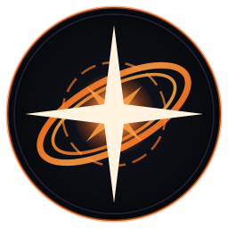
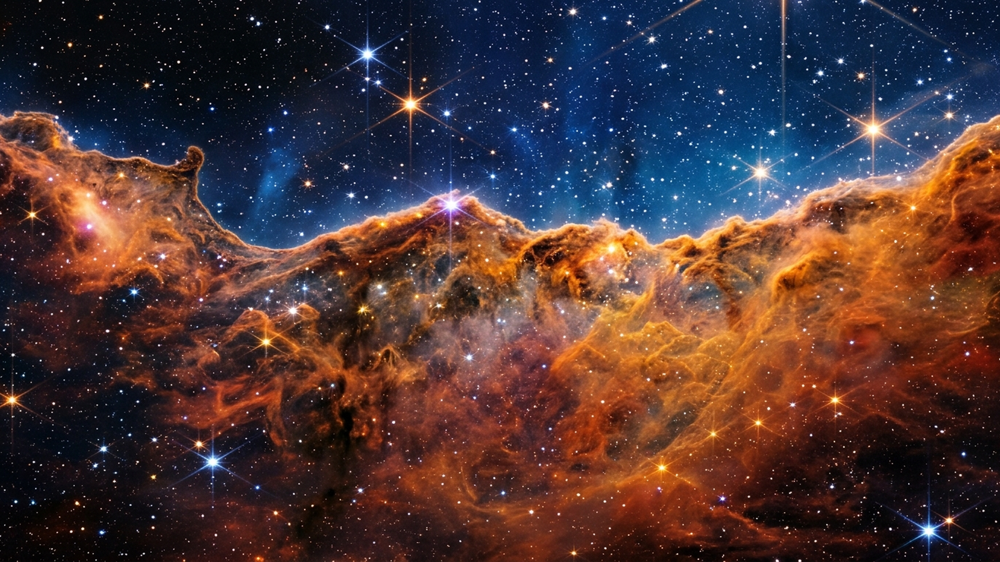

# NovOS Branding & Nova Dark Design System

[**← Back to README**](../README.md) · [**System Architecture**](ARCHITECTURE.md) · [**Build & QEMU Verification**](BUILD_AND_TEST.md) · [**Modular Profiles**](PROFILES.md)

---

## 1. Visual Identity ("Nova" 2026.10)

NovOS 2026.10 ("Nova") uses a cohesive **Deep Obsidian Space & Supernova Accretion** visual theme across every layer of the operating system—from the Limine bootloader and COSMIC desktop (`Dark.ron`) down to the Calamares installer and terminal ANSI colors.

<div align="center">

| Supernova Emblem (`branding/novos-logo.svg`) | Photorealistic Cosmic Supernova (`branding/nova-wallpaper.png`) |
| :---: | :---: |
|  |  |

</div>

### Emblem Geometry
The **NovOS Supernova Emblem** consists of four geometric layers:
1. **Deep Obsidian Circular Badge:** Radial gradient (`#1B1B1B` inner → `#121521` mid → `#0B0C10` outer rim) framed by a `#FFAD00` Cosmic Amber-Orange outer glow ring and `#262626` inner bezel.
2. **Tilted Accretion Rings (`-28°`):** Dual elliptical accretion rings sweeping from **Nova Orange (`#FF6B1A`)** through **Cosmic Amber (`#FFAD00`)** to **Warm Amber (`#FFB347`)**, paired with a dashed inner orbital ring.
3. **Supernova Core Halo & Diagonal Rays:** Radial core glow beneath `45°` secondary star rays (`#FFAD00`).
4. **Radiant 4-Point Star Flare Nucleus:** High-luminance **Starlight White (`#FFF3E0`)** 4-point flare and central core.

---

## 2. Nova Dark & COSMIC (`Dark.ron`) Color Palette Tokens

| Token Name | Hex Code | RGB / Normalized Float | Usage Across NovOS |
| :--- | :--- | :--- | :--- |
| **Obsidian Void** | `#0B0C10` | `rgb(11, 12, 16)` | Deep space backdrop (Limine canvas, Calamares sidebar, wallpaper peripheral vignette) |
| **COSMIC Dark Surface (`bg_color` / `gray_1`)** | `#1B1B1B` | `rgb(27, 27, 27)` / `(0.1059, 0.1059, 0.1059)` | Primary COSMIC Dark background (`Dark.ron`), centered accretion-swirl dark grayscale base |
| **COSMIC Elevated Gray (`gray_2`)** | `#262626` | `rgb(38, 38, 38)` | COSMIC secondary container surface, emblem inner bezel |
| **Cosmic Surface** | `#0F121C` | `rgb(15, 18, 28)` | Calamares main window canvas (`#mainApp`), offset splatter indigo backdrop |
| **Nebula Indigo** | `#121521` | `rgb(18, 21, 33)` | Primary NovOS Deep Indigo wallpaper canvas, badge interior |
| **Elevated Control** | `#161B29` | `rgb(22, 27, 41)` | Calamares inputs, dropdowns, tree views, progress bars, centered indigo center lift |
| **Interactive Surface** | `#1C2233` | `rgb(28, 34, 51)` | Action buttons (`QPushButton`), combo-box drop-down arrows |
| **Flat Monochrome Indigo Logo** | `#2D3856` | `rgb(45, 56, 86)` | Centered accretion-swirl lightened flat monochrome emblem on untouched darker indigo negative-space disk (`r_circ <= 0.235`) |
| **Flat Monochrome Charcoal Logo** | `#34343A` | `rgb(52, 52, 58)` | Centered accretion-swirl lightened flat monochrome emblem on untouched charcoal negative-space disk (`r_circ <= 0.235`) |
| **Grayscale Splatter Slate** | `#2B2B30` / `#3D3D44` | `rgb(43, 43, 48)` / `rgb(61, 61, 68)` | Dark mode monochrome paint splatter and motion droplet trail |
| **COSMIC Neutral Tint (`neutral_5`)** | `#636363` | `rgb(99, 99, 99)` | `Dark.ron` `neutral_tint` surface token |
| **Cosmic Amber (`accent` / `accent_orange`)** | `#FFAD00` | `rgb(255, 173, 0)` / `(1.0, 0.6784, 0.0)` | Primary COSMIC Dark accent (`Dark.ron`), accretion swirl core, dark stencil outline, accretion rings |
| **Nova Orange** | `#FF6B1A` | `rgb(255, 107, 26)` / `(1.0, 0.4196, 0.1020)` | Supernova outer accretion glow, paint splatter burst, `/etc/os-release` `ANSI_COLOR`, Calamares active focus |
| **COSMIC Success (`bright_green`)** | `#5EDB8C` | `rgb(94, 219, 140)` | `Dark.ron` `success` semantic token |
| **COSMIC Warning (`bright_orange`)** | `#FFA37D` | `rgb(255, 163, 125)` | `Dark.ron` `warning` semantic token |
| **COSMIC Destructive (`bright_red`)** | `#FFA09A` | `rgb(255, 160, 154)` | `Dark.ron` `destructive` semantic token |
| **Starlight Core** | `#FFF3E0` | `rgb(255, 243, 224)` | Supernova 4-point star flare, bright starfield nodes |
| **COSMIC Text Tint** | `#F5F5F5` | `rgb(245, 245, 245)` | `Dark.ron` `text_tint` foreground |
| **Crisp Alabaster** | `#F4F6FB` | `rgb(244, 246, 251)` | Primary UI typography (`>15:1` contrast ratio) |
| **Warm Secondary Text** | `#EBDBB2` | `rgb(235, 219, 178)` | Calamares sidebar inactive text, Limine terminal foreground |

---

## 3. Photorealistic Nova, Centered Accretion-Swirl & Offset Motion Paint-Splatter Wallpaper Suite

All branding assets and multi-aspect wallpapers in [`branding/`](../branding/) are synthesized by [`scripts/generate-branding-assets.py`](../scripts/generate-branding-assets.py) from the photorealistic supernova master (`branding/nova-realistic-base.png`) and procedural accretion-swirl / paint-splatter stencil pipelines:

```bash
# Regenerate all SVG and multi-aspect PNG branding assets:
python3 scripts/generate-branding-assets.py
```

### 3.1 Core Identity & Photorealistic Cosmic Supernova Wallpapers

| Generated File | Resolution / Aspect | Description |
| :--- | :--- | :--- |
| [`branding/novos-logo.svg`](../branding/novos-logo.svg) | `256×256` SVG | Vector Supernova emblem (`#FFAD00` / `#FF6B1A` accretion rings on `#1B1B1B` / `#0B0C10` obsidian badge) |
| [`branding/novos-logo.png`](../branding/novos-logo.png) | `256×256` RGBA PNG | Anti-aliased raster Supernova emblem for Calamares and system pixmaps |
| [`branding/nova-wallpaper.svg`](../branding/nova-wallpaper.svg) | `1920×1080` (`16:9`) SVG | Vector cosmic space backdrop, 140-star deterministic starfield (`seed=0x4E4F5641`), and horizon nebula arc |
| [`branding/nova-realistic-base.png`](../branding/nova-realistic-base.png) | Master PNG | High-resolution photorealistic Cosmic Supernova remnant master with `#FFAD00` / `#FF6B1A` accretion dust clouds and volumetric starlight filaments |
| [`branding/nova-realistic-16x9.png`](../branding/nova-realistic-16x9.png) | `3840×2160` (`16:9` 4K UHD) | Photorealistic Cosmic Supernova 4K UHD desktop wallpaper |
| [`branding/nova-realistic-32x9.png`](../branding/nova-realistic-32x9.png) | `5120×1440` (`32:9` Dual-QHD) | Photorealistic Cosmic Supernova Super-Ultrawide desktop wallpaper |
| [`branding/nova-wallpaper.png`](../branding/nova-wallpaper.png) | `1920×1080` (`16:9` Full HD) | Default Full HD alias derived from the realistic Nova master for Limine bootloader, Calamares slideshow, and default COSMIC background compatibility |

### 3.2 Centered Accretion-Swirl & Offset Motion Paint-Splatter Stencil Wallpapers (`16:9` & `32:9`, Indigo & Dark Grayscale)

NovOS ships 8 artistic minimalist variants across two signature compositions, two color modes (**NovOS Deep Indigo** `#121521`/`#161B29` and **Dark Charcoal Grayscale** `#1B1B1B`/`#121214`), and two aspect ratios (`16:9` `3840×2160` and `32:9` `5120×1440`):

* **Style 1 — Centered Accretion-Swirl & Flat Monochrome Logo (`nova-minimal-faceted-*`):**
  * **Strict Negative-Space Central Disk & Fuzzy Accretion Border:** Defines a circular negative-space background disk (`r_circ = hypot(xn, yn)`) around the centered logo (`logo_radius = 0.21 × H`). Inside `r_circ <= 0.235` (covering the entire logo plus a clear negative-space margin around the star tips and accretion rings), `orange_weight` is strictly `0.0` so orange never touches or bleeds into the logo area. Immediately outside `r_circ = 0.235`, the swirling NovOS Orange (`#FF6B1A` / `#FFAD00`) accretion disk ramps smoothly (`smoothstep` from `r_circ = 0.235` to `0.33`) to form a soft, fuzzy glowing border framing the logo's dark background disk, fed by diffused top and bottom edge inflow gradients.
  * **Indigo Mode (`light`):** Darker NovOS Deep Indigo (`#121521` / `#161B29`) background with a `#0B0C10` peripheral vignette and the centered flat-shaded monochrome logo rendered in lighter indigo (`#2D3856`) on the untouched darker indigo negative-space disk.
  * **Dark Grayscale Mode (`dark`):** Charcoal grayscale background (`#1B1B1B` center → `#0B0C10` peripheral vignette) with the centered flat-shaded monochrome logo rendered in lighter neutral gray (`#34343A`) on the untouched charcoal negative-space disk, surrounded by the fuzzy NovOS Orange accretion border.
* **Style 2 — Offset Motion Paint-Splatter & Stenciled Logo (`nova-minimal-silhouette-*`):**
  * **Asymmetric Ovoid / Teardrop Main Splatter Spot (`cx ≈ 0.70 × W, cy ≈ 0.50 × H`):** Reshapes the main splash body into an asymmetric tilted ovoid/teardrop spot (`a_x ≈ 1.24 × r_base`, `b_y ≈ 0.88 × r_base`, with a rounded impact front on the right and a tapered/flaring wake on the left) whose high-velocity splash spikes, ragged liquid fingers, and elongated spray filaments flare predominantly backward (to the left/upper-left/lower-left) and outward at oblique angles.
  * **Elongated Droplets, Turbulent Dispersion & Steep Power-Law Size Diversity:** Trail and corona droplets are elongated (`2.0× .. 5.5×` teardrop/streak aspect ratio aligned with local trajectory vectors plus angular scatter) with irregular, turbulent dispersion (clustered splatter bursts, erratic lateral whip trajectories, and natural void pockets) and a steep Pareto power-law size distribution (`~78` large/medium-large drops heavily interspersed with `3,000+` fine/small elongated specks and mist droplets surrounding every large drop, preserving progressive left-to-right max droplet growth across `0.08 × W .. 0.70 × W`).
  * **Indigo / NovOS Orange Splatter Mode (`light`):** NovOS Deep Indigo (`#121521` / `#0F121C` with `#0B0C10` edge vignette) canvas with vibrant NovOS Orange (`#FF6B1A` / `#FFAD00`) paint and a crisp stenciled NovOS Supernova logo centered inside the ovoid splatter spot.
  * **Dark Grayscale + Orange Stencil Outline Mode (`dark`):** Charcoal/slate grayscale background (`#121214` / `#0B0C10`) and paint (`#2B2B30` / `#3D3D44`) with a luminous NovOS Orange (`#FFAD00` / `#FF6B1A`) outline around the stenciled NovOS Supernova logo.

| Generated File | Style | Theme Mode | Aspect / Resolution |
| :--- | :--- | :--- | :--- |
| [`branding/nova-minimal-faceted-dark-16x9.png`](../branding/nova-minimal-faceted-dark-16x9.png) | **Style 1:** Centered Accretion-Swirl + Negative-Space Disk + Flat Monochrome Logo (`#34343A`) | Dark Grayscale (`#1B1B1B` → `#0B0C10` + Fuzzy `#FF6B1A`/`#FFAD00` Accretion Border) | `16:9` (`3840×2160`) |
| [`branding/nova-minimal-faceted-dark-32x9.png`](../branding/nova-minimal-faceted-dark-32x9.png) | **Style 1:** Centered Accretion-Swirl + Negative-Space Disk + Flat Monochrome Logo (`#34343A`) | Dark Grayscale (`#1B1B1B` → `#0B0C10` + Fuzzy `#FF6B1A`/`#FFAD00` Accretion Border) | `32:9` (`5120×1440`) |
| [`branding/nova-minimal-faceted-light-16x9.png`](../branding/nova-minimal-faceted-light-16x9.png) | **Style 1:** Centered Accretion-Swirl + Negative-Space Disk + Flat Monochrome Logo (`#2D3856`) | NovOS Indigo (`#121521`/`#161B29` → `#0B0C10` + Fuzzy `#FF6B1A`/`#FFAD00` Accretion Border) | `16:9` (`3840×2160`) |
| [`branding/nova-minimal-faceted-light-32x9.png`](../branding/nova-minimal-faceted-light-32x9.png) | **Style 1:** Centered Accretion-Swirl + Negative-Space Disk + Flat Monochrome Logo (`#2D3856`) | NovOS Indigo (`#121521`/`#161B29` → `#0B0C10` + Fuzzy `#FF6B1A`/`#FFAD00` Accretion Border) | `32:9` (`5120×1440`) |
| [`branding/nova-minimal-silhouette-dark-16x9.png`](../branding/nova-minimal-silhouette-dark-16x9.png) | **Style 2:** Asymmetric Ovoid Motion Splatter + Turbulent Pareto Trail + Stenciled Logo | Dark Grayscale (`#121214`/`#2B2B30`) + `#FFAD00`/`#FF6B1A` Stencil Outline | `16:9` (`3840×2160`) |
| [`branding/nova-minimal-silhouette-dark-32x9.png`](../branding/nova-minimal-silhouette-dark-32x9.png) | **Style 2:** Asymmetric Ovoid Motion Splatter + Turbulent Pareto Trail + Stenciled Logo | Dark Grayscale (`#121214`/`#2B2B30`) + `#FFAD00`/`#FF6B1A` Stencil Outline | `32:9` (`5120×1440`) |
| [`branding/nova-minimal-silhouette-light-16x9.png`](../branding/nova-minimal-silhouette-light-16x9.png) | **Style 2:** Asymmetric Ovoid Motion Splatter + Turbulent Pareto Trail + Stenciled Logo | NovOS Indigo (`#121521`/`#0F121C`) + `#FF6B1A`/`#FFAD00` Motion Splatter | `16:9` (`3840×2160`) |
| [`branding/nova-minimal-silhouette-light-32x9.png`](../branding/nova-minimal-silhouette-light-32x9.png) | **Style 2:** Asymmetric Ovoid Motion Splatter + Turbulent Pareto Trail + Stenciled Logo | NovOS Indigo (`#121521`/`#0F121C`) + `#FF6B1A`/`#FFAD00` Motion Splatter | `32:9` (`5120×1440`) |

---

## 4. OS-Wide Theme Integration

### 4.1 OS Identity & Terminal ANSI Accent (`/usr/lib/os-release`)
Configured in [`scripts/stages/03-core-system.sh`](../scripts/stages/03-core-system.sh):
* `PRETTY_NAME="NovOS 2026.10 (Nova)"`
* `ANSI_COLOR="38;2;255;173;0"` (TrueColor `#FFAD00` Cosmic Amber in `fastfetch`, `neofetch`, and `systemd` boot banners)

### 4.2 Limine Bootloader Canvas Theme (`limine.conf`)
Configured in [`scripts/stages/03-core-system.sh`](../scripts/stages/03-core-system.sh) and [`scripts/stages/06-snapshot-finalize.sh`](../scripts/stages/06-snapshot-finalize.sh):
```ini
timeout: 5
default_entry: 1
wallpaper: boot():/limine/nova-wallpaper.png
term_backend: canvas
term_palette: 1b1b1b;ffad00;ff6b1a;ffb347;63d0df;e79cfe;5edb8c;f5f5f5
```

### 4.3 COSMIC Desktop (`Dark.ron`) & `cosmic-greeter` Theme Provisioning
Configured in [`Dark.ron`](../Dark.ron) and [`scripts/stages/04-cosmic-desktop.sh`](../scripts/stages/04-cosmic-desktop.sh) (`provision_cosmic_theme`):
* Installed across `/etc/skel/.config/cosmic`, `/home/devuser/.config/cosmic`, `/var/lib/cosmic-greeter/.config/cosmic`, and `/var/lib/greetd/.config/cosmic`:
  * **Dark Mode Enforced:** `com.system76.CosmicTheme.Mode/v1/is_dark` → `true`
  * **Cosmic Amber Accent (`#FFAD00`):** `com.system76.CosmicTheme.Dark.Builder/v1/accent` → `(red: 1.0, green: 0.6784314, blue: 0.0)`
  * **Complete `Dark.ron` Theme Palette:** Frosted glass (`frosted: Medium`, `frosted_windows: true`, `frosted_panel: true`, `frosted_applets: true`), `#1B1B1B` background (`bg_color`), `#636363` neutral tint, `#F5F5F5` text tint, `gaps: (0, 8)`, and `active_hint: 3`.
  * **Full Wallpaper Suite Provisioned in `/usr/share/backgrounds/novos/`:** Default background bound in `com.system76.CosmicBackground/v1/all` and `com.system76.CosmicBg/v1/all` to `/usr/share/backgrounds/novos/nova-wallpaper.png` (`Lanczos` scaling, `Zoom` mode), with all `16:9` (`3840×2160`) and `32:9` (`5120×1440`) photorealistic, centered accretion-swirl, and offset paint-splatter stencil wallpapers available in COSMIC Settings → Desktop → Wallpaper.
* **System Icons & Pixmaps:** Installed to `/usr/share/pixmaps/novos-logo.{svg,png}` and `/usr/share/icons/hicolor/scalable/apps/novos-logo.svg`.

### 4.4 Calamares Installer High-Contrast Nova Dark Theme
Configured in [`calamares/branding/novos/branding.desc`](../calamares/branding/novos/branding.desc) and [`calamares/branding/novos/stylesheet.qss`](../calamares/branding/novos/stylesheet.qss):
* **Sidebar Palette (`branding.desc`):** `#1B1B1B` / `#0B0C10` background, `#F4F6FB` text, `#FFAD00` active step accent, and `#161B29` current-step highlight (supports both Calamares 3.2 and 3.3+ style keys).
* **Qt Stylesheet (`stylesheet.qss`):** Overrides default light Qt/Fusion widgets when Calamares runs under `sudo -E calamares`, painting `#0F121C` window surfaces, `#F4F6FB` high-contrast labels, `#161B29` input controls, and `#FFAD00` / `#FF6B1A` buttons, focus rings, checkboxes, and progress bars.
* **Installation Slideshow (`show.qml`):** Displays `nova-wallpaper.png` with a translucent `#0B0C10` (`opacity: 0.82`) rounded card overlay bordered in `#FFAD00` during filesystem unpacking and bootloader installation.
