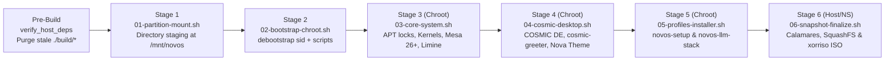

# NovOS Build & QEMU Verification Guide

[**← Back to README**](../README.md) · [**System Architecture**](ARCHITECTURE.md) · [**Modular Profiles**](PROFILES.md) · [**Branding & Nova Theme**](BRANDING_AND_THEME.md)

---

## 1. Fresh End-to-End Build Policy (Mandatory Invariant)

> [!IMPORTANT]
> **All builds and verification tests MUST run fresh from Stage 1 through Stage 6.**
> Never validate architectural or script changes by resuming from an intermediate stage (`--from-stage`). Resuming from a partial stage masks regressions in earlier stages and cross-stage state transitions.

### Standard Build & Verification Sequence

```bash
# 1. Build a fresh Clean-Room Hybrid Live + Calamares Installer ISO (Stages 1-6)
sudo ./scripts/build-novos.sh --target-iso ./build/NovOS-sid-amd64.iso

# 2. Boot and verify the ISO in QEMU/KVM (UEFI OVMF + fresh NVRAM variables)
./scripts/test-qemu.sh --iso ./build/NovOS-sid-amd64.iso --reset-vars
```

---

## 2. Host Build Dependencies

[`scripts/lib/verify-deps.sh`](../scripts/lib/verify-deps.sh) (`verify_host_deps "iso"`) automatically checks for and installs any missing host dependencies via `apt-get` at the start of `build-novos.sh`.

| Category | Required Host Packages | Required Host Binaries |
| :--- | :--- | :--- |
| **Bootstrap & Chroot** | `debootstrap`, `util-linux`, `coreutils`, `gawk`, `curl`, `wget`, `ca-certificates`, `gnupg` | `debootstrap`, `unshare`, `chroot`, `mount`, `umount`, `findmnt`, `blkid` |
| **Filesystem & Compression** | `dosfstools`, `mtools`, `squashfs-tools`, `zstd`, `xz-utils`, `kmod` | `mkfs.vfat`, `mcopy`, `mksquashfs`, `zstd`, `xz` |
| **ISO Packaging** | `xorriso`, `isolinux`, `syslinux-common`, `ovmf` | `xorriso` |

---

## 3. Declarative Build Configuration ([`config/build.env`](../config/build.env))

All build-time constants are centralized in [`config/build.env`](../config/build.env):

| Variable | Default Value | Description |
| :--- | :--- | :--- |
| `DISTRO_NAME` | `"NovOS"` | Human-readable distribution name |
| `DISTRO_ID` | `"novos"` | `/etc/os-release` `ID` token |
| `DISTRO_VERSION` | `"2026.10"` | Release version string |
| `DISTRO_CODENAME` | `"nova"` | Release codename |
| `DEBIAN_SUITE` | `"sid"` | Upstream Debian suite bootstrapped via `debootstrap` |
| `DEBIAN_MIRROR` | `"http://deb.debian.org/debian"` | Upstream Debian APT mirror |
| `TARGET_HOSTNAME` | `"novos"` | Default system hostname |
| `TARGET_TIMEZONE` | `"America/Chicago"` | Default timezone configured in Stage 3 |
| `TARGET_LOCALE` | `"en_US.UTF-8"` | Default UTF-8 locale |
| `DEFAULT_USER` | `"devuser"` | Default live/initial user account |
| `DEFAULT_ROOT_PASS` | `"novos"` | Default `root` password in Live environment |
| `DEFAULT_USER_PASS` | `"novos"` | Default `devuser` password in Live environment |
| `ESP_SIZE_MIB` | `"6144"` | Reference EFI System Partition size (`6 GiB`) |
| `ESP_LABEL` | `"NOVOS_EFI"` | FAT32 boot partition filesystem label |
| `ROOT_LABEL` | `"NOVOS_ROOT"` | Btrfs root filesystem label |
| `MOUNT_ROOT` | `"/mnt/novos"` | Host staging directory for clean-room chroot assembly |
| `ISO_PATH` | `"./build/NovOS-sid-amd64.iso"` | Default output path for the compiled hybrid ISO |
| `MAX_SNAPSHOTS` | `"5"` | Maximum retained Snapper root snapshots in Limine |
| `MAX_HISTORICAL_KERNELS` | `"2"` | Maximum unreferenced historical kernels kept on `/boot/efi` |
| `BUILD_PROFILES` | `"none"` | Comma-separated profiles (`gaming,dev,llm,network` or `none`) pre-installed during Stage 5 |

---

## 4. Clean-Room 6-Stage Build Pipeline

[`scripts/build-novos.sh`](../scripts/build-novos.sh) re-executes itself inside an isolated Linux mount, PID, IPC, and UTS namespace (`unshare --mount --pid --fork --ipc --uts --propagation private`) so chroot bind mounts (`/proc`, `/sys`, `/dev`, `/dev/pts`, `/run`) never pollute the host operating system and are deterministically torn down on exit.



### Stage-by-Stage Breakdown & Post-Condition Gates

Every stage ends with a strict verification gate defined in [`scripts/lib/verify-deps.sh`](../scripts/lib/verify-deps.sh):

| Stage | Script | Execution Context | Responsibilities | Post-Condition Gate (`verify-deps.sh`) |
| :---: | :--- | :--- | :--- | :--- |
| **1** | [`01-partition-mount.sh`](../scripts/stages/01-partition-mount.sh) | Host (Clean Namespace) | Cleans `/mnt/novos`, creates private bind mount, provisions FHS + 10 subvolume directory hierarchy (`/srv/llm/*`, `/srv/devshare`, `/var/lib/docker`, etc.) and `/var/lib/ollama` symlink. | `verify_stage1_post`: Confirms `/mnt/novos` is a mountpoint and all required directories exist. |
| **2** | [`02-bootstrap-chroot.sh`](../scripts/stages/02-bootstrap-chroot.sh) | Host (Clean Namespace) | Runs `debootstrap --arch=amd64 sid` with `systemd-sysv`, `libpam-systemd`, and `dbus-user-session` baked in; writes placeholder `/etc/fstab`; copies `config/`, `scripts/`, `branding/`, and `calamares/` into `/mnt/novos/root/novos-build/`. | `verify_stage2_post`: Verifies `/bin/bash`, `/usr/bin/apt-get`, `/etc/fstab`, and staged build scripts. |
| **3** | [`03-core-system.sh`](../scripts/stages/03-core-system.sh) | Chroot (`/mnt/novos`) | Configures `00-protect-core` & `01-novos-safety`; adds 3rd-party GPG keyrings; enforces `pam_systemd.so`; configures `/etc/os-release` (`ID=novos`); installs `linux-xanmod-x64v3` + `linux-image-amd64`; builds `dracut` initramfs images; installs Mesa 26+ RDNA 4 drivers; builds Limine `v8.x-binary` and installs `zz-sync-limine` + `update-limine-snapshots`. | `verify_stage3_post`: Verifies `ID=novos`, `pam_systemd.so`, `dracut`, `btrfs`, `snapper`, `BOOTX64.EFI`, `vmlinuz-primary`, `vmlinuz-lts-fallback`, and `limine.conf`. |
| **4** | [`04-cosmic-desktop.sh`](../scripts/stages/04-cosmic-desktop.sh) | Chroot (`/mnt/novos`) | Installs `cosmic-epoch-monorepo`, `cosmic-utils-monorepo`, `greetd`, `tuigreet`, `pipewire-audio`, `flatpak`; masks `seatd.service`; configures `/etc/pam.d/cosmic-greeter`, D-Bus policy, `cosmic-greeter-launch`, and `cosmic-session-launch`; backfills `CosmicTheme` `v2` (`list_button`, `is_frosted`); provisions Nova wallpaper and COSMIC Dark accent. | `verify_stage4_post`: Verifies `start-cosmic`, `cosmic-comp`, `cosmic-greeter`, `tuigreet`, `cosmic-greeter-launch`, `nova-wallpaper.png`, and `novos-logo.svg`. |
| **5** | [`05-profiles-installer.sh`](../scripts/stages/05-profiles-installer.sh) | Chroot (`/mnt/novos`) | Configures `/etc/profile.d/novos-env.sh` (`HF_HOME`, `OLLAMA_MODELS`), `/srv/llm/docker-compose.yml` (ComfyUI + Open WebUI with ROCm `/dev/kfd` & `/dev/dri` passthrough), `/usr/local/bin/novos-llm-stack`, and `/usr/local/bin/novos-setup`. Optionally pre-installs profiles if `--profiles` was passed. | `verify_stage5_post`: Verifies `novos-setup`, `novos-llm-stack`, and `/srv/llm/docker-compose.yml`. |
| **6** | [`06-snapshot-finalize.sh`](../scripts/stages/06-snapshot-finalize.sh) | Host (Clean Namespace) | Runs 25+ pre-flight binary/file checks; installs `live-boot`, `calamares`, and local `novos-profile-*` APT repository (`/var/local/novos-profile-repo`); installs Calamares `novos` branding (`stylesheet.qss`, `branding.desc`, `show.qml`) and `limine-bootloader` module; builds live `dracut` initrd (`dmsquash-live`); packs `filesystem.squashfs` (`zstd`); generates dual BIOS/UEFI `NovOS-sid-amd64.iso` via `xorriso` + `limine bios-install`. | `verify_stage6_post`: Verifies ISO file exists and is `> 100 MiB`. |

---

## 5. CLI Reference: `scripts/build-novos.sh`

```text
Usage: sudo ./scripts/build-novos.sh [OPTIONS]

Target Options (defaults to --target-iso ./build/NovOS-sid-amd64.iso):
  --target-iso [path.iso]       Build Clean-Room Hybrid Live + Calamares Installer ISO

Build Options:
  --profiles <list>             Comma-separated profiles to pre-install at Stage 5:
                                gaming,dev,llm,network (default: none)
  --help                        Show help message
```

---

## 6. QEMU/KVM Verification Harness (`scripts/test-qemu.sh`)

[`scripts/test-qemu.sh`](../scripts/test-qemu.sh) boots the generated Live ISO inside a hardware-accelerated QEMU/KVM virtual machine using OVMF UEFI firmware (`OVMF_CODE_4M.fd` + local `build/ovmf_vars.fd`), a 64 GiB persistent virtual target disk (`build/novos-calamares-target.img`) for testing Calamares installation, and VirtIO GPU graphics.

### Usage & Options

```bash
# Default verification run (8 GiB RAM, 4 vCPUs, fresh UEFI NVRAM vars):
./scripts/test-qemu.sh --iso ./build/NovOS-sid-amd64.iso --reset-vars

# Custom RAM/CPU allocation or OpenGL 3D acceleration (--gl):
./scripts/test-qemu.sh --iso ./build/NovOS-sid-amd64.iso --ram 16384 --cpus 8 --gl --reset-vars
```

| Flag | Default | Description |
| :--- | :--- | :--- |
| `--iso <path>` | `./build/NovOS-sid-amd64.iso` | Path to the Hybrid Live ISO to boot |
| `--ram <MB>` | `8192` | Guest memory allocation in MiB |
| `--cpus <N>` | `4` | Number of guest vCPUs (`-cpu host -smp <N>`) |
| `--reset-vars` | `false` | Resets `./build/ovmf_vars.fd` from the clean OVMF template |
| `--gl` | `false` | Enables `virtio-vga-gl` (`-display gtk,gl=on`) instead of standard `virtio-vga` |

### Static Syntax & Self-Test Gates (Sandboxed / Non-Root)
Before running a full privileged build, verify all scripts and Python modules statically:

```bash
# 1. Verify bash syntax across all orchestrator and stage scripts:
bash -n scripts/build-novos.sh scripts/test-qemu.sh scripts/lib/verify-deps.sh scripts/stages/*.sh

# 2. Verify Python syntax and run the Calamares Limine module unit self-test:
python3 -m py_compile scripts/generate-branding-assets.py calamares/modules/limine-bootloader/main.py
python3 calamares/modules/limine-bootloader/main.py --self-test

# 3. Run the unified verification & Nebulous self-test gate suite:
./scripts/lib/verify-deps.sh --self-test
```

---

## 7. Dockerized Clean-Room Build, Containerized QEMU (`/srv/docker-vms`) & Local LLM Host (`/srv/docker-llms`)

[`docker/docker-compose.ci.yml`](../docker/docker-compose.ci.yml) defines three isolated container services on the Pop!_OS workstation so full Stage 1–6 ISO builds, UEFI QEMU/KVM verification runs, and local `llama.cpp` (`Qwen3-14B-Q4_K_M.gguf`) self-healing root-cause diagnostics run reproducibly without mutating the host operating system:

| Service | Image / Dockerfile | Key Mounts / Devices / Ports | Purpose |
| :--- | :--- | :--- | :--- |
| **`novos-builder`** | [`docker/Dockerfile.builder`](../docker/Dockerfile.builder) | `privileged: true`, `..:/workspace`, `../build/cache/apt:/cache/apt`, `../build/cache/cargo:/cache/cargo` | Runs fresh Stage 1–6 `build-novos.sh` clean-room ISO builds with persistent APT & Cargo caches. |
| **`novos-qemu-tester`** | [`docker/Dockerfile.qemu-tester`](../docker/Dockerfile.qemu-tester) | `/dev/kvm:/dev/kvm`, `/dev/dri:/dev/dri`, `127.0.0.1:5900:5900` (VNC), `127.0.0.1:6080:6080` (noVNC), `..:/workspace`, `/srv/docker-vms:/vms` | Runs [`scripts/test-docker-qemu.py`](../scripts/test-docker-qemu.py) against `./build/NovOS-sid-amd64.iso` storing persistent 64 GiB VirtIO target disks (`novos-calamares-target.img`), OVMF NVRAM vars (`ovmf_vars.fd`), and QMP artifacts in `/srv/docker-vms`. |
| **`novos-llm-host`** | `ghcr.io/ggml-org/llama.cpp:server-vulkan` | `/dev/dri:/dev/dri`, `/dev/kfd:/dev/kfd`, `127.0.0.1:8081:8080`, `/srv/docker-llms:/models` | Hosts `Qwen3-14B-Q4_K_M.gguf` on port `8081` (`http://127.0.0.1:8081/v1`) with RDNA 4 (`gfx1201`) Vulkan/ROCm GPU offload (`-ngl 99 -c 16384 --flash-attn`) for automated failure log diagnostics. |

### Pop!_OS Host Environment Setup (`scripts/setup-popos-test-env.sh`)

```bash
# 1. Verify /dev/kvm, /dev/dri, /dev/kfd, /srv/docker-vms, and /srv/docker-llms status:
./scripts/setup-popos-test-env.sh --status

# 2. Download Qwen3-14B-Q4_K_M.gguf into /srv/docker-llms:
./scripts/setup-popos-test-env.sh --pull-model

# 3. Start the novos-llm-host container (port 8081) and build novos-qemu-tester:
./scripts/setup-popos-test-env.sh --start-llm
```

### Containerized Build & Verification Commands

```bash
# 1. Run a fresh Stage 1-6 clean-room ISO build inside the builder container:
docker compose -f docker/docker-compose.ci.yml run --rm novos-builder \
  ./scripts/build-novos.sh --target-iso ./build/NovOS-sid-amd64.iso

# 2. Tier 1 (live-boot): Headless UEFI OVMF boot + QMP screendump + live guest self-tests:
docker compose -f docker/docker-compose.ci.yml run --rm novos-qemu-tester \
  ./scripts/test-docker-qemu.py --iso ./build/NovOS-sid-amd64.iso --tier live-boot --no-vnc

# 3. Tier 1 with interactive VNC (127.0.0.1:5900) and browser noVNC (http://127.0.0.1:6080):
docker compose -f docker/docker-compose.ci.yml run --rm --service-ports novos-qemu-tester \
  ./scripts/test-docker-qemu.py --iso ./build/NovOS-sid-amd64.iso --tier live-boot --vnc

# 4. Tier 2 (install-e2e): Full installation to 64 GiB VirtIO target disk (/srv/docker-vms) + installed reboot check:
docker compose -f docker/docker-compose.ci.yml run --rm novos-qemu-tester \
  ./scripts/test-docker-qemu.py --iso ./build/NovOS-sid-amd64.iso --tier install-e2e --no-vnc
```

### CLI Reference: `scripts/test-docker-qemu.py`

| Flag | Default | Description |
| :--- | :--- | :--- |
| `--iso <path>` | `./build/NovOS-sid-amd64.iso` | Path to the built Hybrid Live ISO to verify |
| `--tier <live-boot\|install-e2e>` | `live-boot` | Verification tier (`live-boot` 420s timeout; `install-e2e` 1200s timeout) |
| `--vnc` / `--no-vnc` | `--no-vnc` | Enable VNC (`:5900`) + noVNC (`:6080`) or run headless (`-display none`) with QMP `screendump` |
| `--item <path>` | `.nebulous/items/item-001-docker-qemu-ci.toml` | Tiered `Item.toml` state file updated with attempt telemetry |
| `--vm-dir <dir>` | `/vms` or `/srv/docker-vms` | Persistent VM storage directory for `novos-calamares-target.img` and `ovmf_vars.fd` |
| `--llm-endpoint <url>` | `http://127.0.0.1:8081/v1` | OpenAI-compatible `llama.cpp` endpoint (`http://novos-llm-host:8080/v1` inside container) |
| `--ram <MiB>` | `8192` | Guest memory allocation in MiB |
| `--cpus <N>` | `4` | Guest vCPU count |
| `--disk <path>` | `<vm-dir>/novos-calamares-target.img` | Target VirtIO disk image (`64 GiB` `qcow2`) |
| `--dry-run` | `false` | Print constructed QEMU command, QMP socket path, and milestone plan without booting |
| `--self-test` | `false` | Run built-in unit tests for QMP commands, PPM/PNG analysis, OVMF discovery, `/srv/docker-vms` resolution, and local LLM telemetry |

---

## 8. Nebulous Tiered TOML, Golden OS Snapshot Variance Lock & CI/CD MCP Guardrails

NovOS enforces deterministic state tracking and anti-regression guardrails through the `.nebulous/` hierarchy, [`scripts/nebulous-ctl.py`](../scripts/nebulous-ctl.py), and the stdio MCP server [`scripts/mcp_nebulous_ci.py`](../scripts/mcp_nebulous_ci.py).

### 8.1 Tiered `.nebulous/` TOML Hierarchy

| File / Pattern | Role |
| :--- | :--- |
| [`.nebulous/project.toml`](../.nebulous/project.toml) | Global project invariants, target ISO path, and active phase references |
| [`.nebulous/manifest.toml`](../.nebulous/manifest.toml) | Authoritative manifest of required packages, Rust workspace crates, custom binaries, Calamares configs, and kernel/boot artifacts |
| [`.nebulous/golden-snapshot.toml`](../.nebulous/golden-snapshot.toml) | Baseline Golden OS Snapshot recording minimum package versions, binary paths, and SquashFS/ISO structural expectations |
| [`.nebulous/phases/*.toml`](../.nebulous/phases/phase-01-ci-foundation.toml) | Phase-level objectives, entry/exit criteria, and child work item IDs |
| [`.nebulous/items/*.toml`](../.nebulous/items/item-001-docker-qemu-ci.toml) | Per-item execution state (`retry_count`, `loop_locked`, `negative_constraints`, and structured `[[attempts]]` log) |

### 8.2 Asymmetric Forward-Only Variance Lock & Loop Breaker (`scripts/nebulous-ctl.py`)

[`scripts/nebulous-ctl.py`](../scripts/nebulous-ctl.py) enforces two non-bypassable guardrails:

1. **Asymmetric Forward-Only Variance Lock (`verify-variance`):**
   - **Allowed (`PASS`):** Package version upgrades (`candidate >= golden` using Debian Policy §5.6.12 comparison) and newly added packages/binaries.
   - **Blocked (`EXIT_VARIANCE_LOCK = 2`):** Any dropped package, missing required binary/config/module, or version downgrade (`candidate < golden`) unless explicitly listed in `.nebulous/approvals.toml` by the host user.
2. **Automated Loop Breaker (`record-attempt` / `check-guardrail`):**
   - Computes normalized error and git diff fingerprints across failed build/test attempts.
   - Injects structured `negative_constraints` into the active `Item.toml` when an error or failed diff repeats, and sets `loop_locked = true` (`EXIT_LOOP_LOCK = 3`) once the retry threshold (`3`) is reached.

```bash
# Run unit self-tests for Debian version comparison, symlink resolution, variance lock, and loop breaker:
./scripts/nebulous-ctl.py --self-test

# Verify repository manifest invariants (no ISO required):
./scripts/nebulous-ctl.py verify-variance --repo-only

# Verify both repository invariants and a built Live ISO against the Golden OS Snapshot:
./scripts/nebulous-ctl.py verify-variance --iso ./build/NovOS-sid-amd64.iso

# Check guardrail status (loop lock, retry count, negative constraints, variance state):
./scripts/nebulous-ctl.py check-guardrail --item .nebulous/items/item-001-docker-qemu-ci.toml --json
```

> [!CAUTION]
> **Host-Only User Approval Commands (`bless-golden`, `approve-variance`, `unlock-loop`):**
> These subcommands require `--user-confirmed-token` and reject execution when `ANTIGRAVITY_AGENT=1` (`EXIT_PERMISSION_DENIED = 4`). Agents must never invoke them or modify `.nebulous/golden-snapshot.toml` / `.nebulous/approvals.toml` directly.

### 8.3 Stdio MCP Server (`scripts/mcp_nebulous_ci.py`)

[`scripts/mcp_nebulous_ci.py`](../scripts/mcp_nebulous_ci.py) exposes 6 typed JSON-RPC 2.0 MCP tools over stdio (configured in [`.agents/mcp.json`](../.agents/mcp.json)):

- `nebulous_get_status`: Returns current phase/item state, `retry_count`, `loop_locked`, `negative_constraints`, and repo variance status.
- `nebulous_verify_variance`: Runs `nebulous-ctl.py verify-variance` and returns structured `HARD_STOP_VARIANCE_LOCK` errors on any unapproved removal or downgrade.
- `nebulous_run_docker_build`: Verifies the item is not loop-locked, runs the clean-room Stage 1–6 build inside `novos-builder`, and enforces post-build variance verification.
- `nebulous_run_qemu_test`: Runs `test-docker-qemu.py` (`live-boot` or `install-e2e`) inside `novos-qemu-tester` and returns structured milestone/screendump telemetry.
- `nebulous_record_diagnostic`: Records diagnostic attempts and triggers loop-breaker negative constraints if a failed diff is repeated.
- `nebulous_consult_local_llm`: Queries the local `llama.cpp` server (`Qwen3-14B-Q4_K_M.gguf` on `http://127.0.0.1:8081/v1`) with failure logs and active `negative_constraints`, records the structured diagnostic hypothesis into `Item.toml` (`[[diagnostics]]`), and returns the root-cause analysis.
